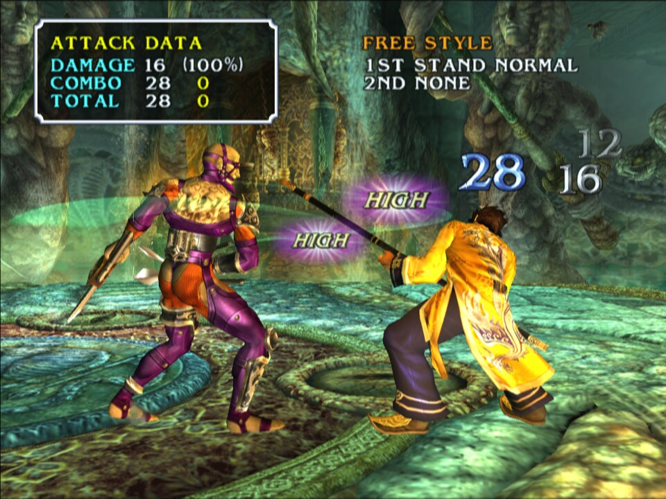
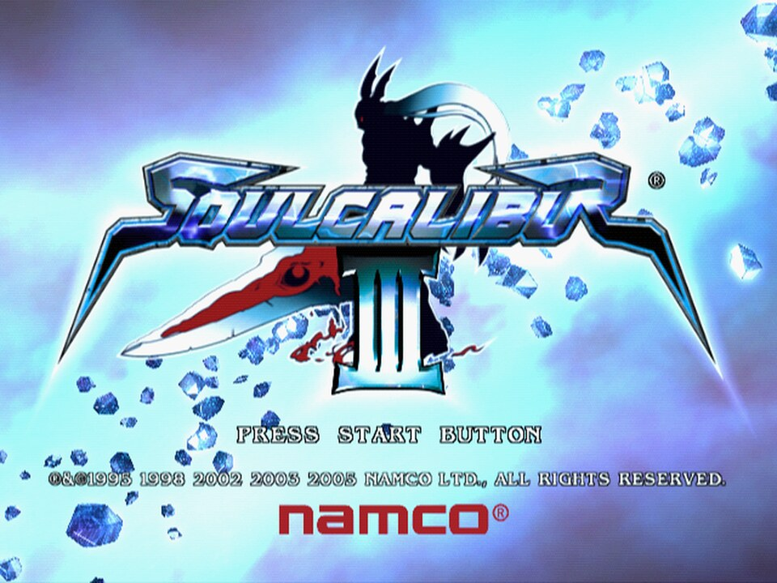
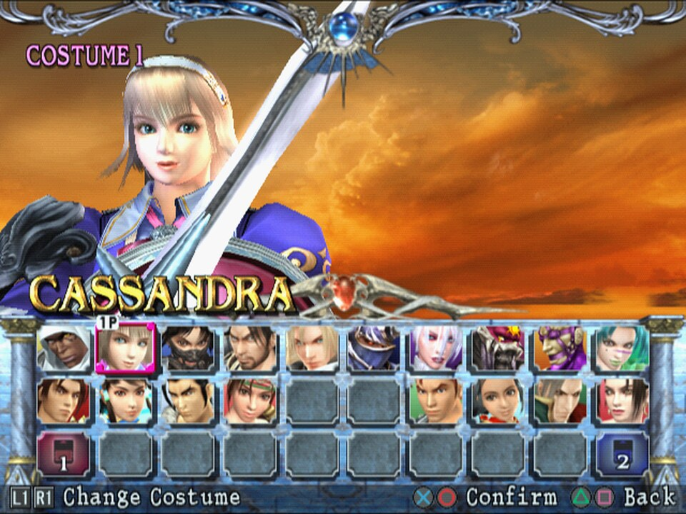
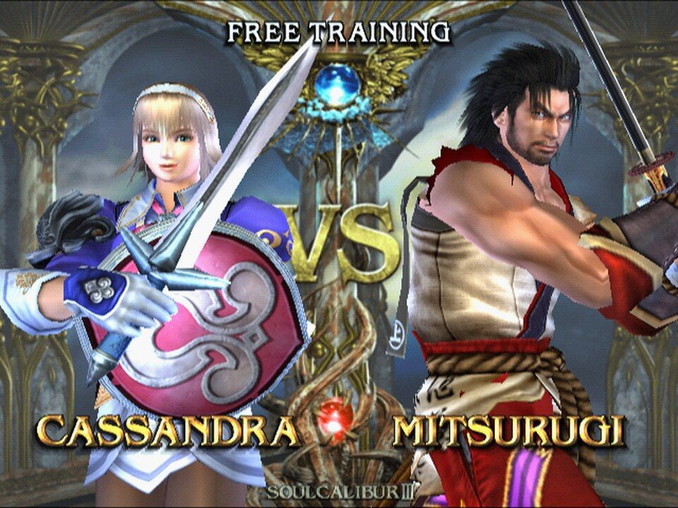
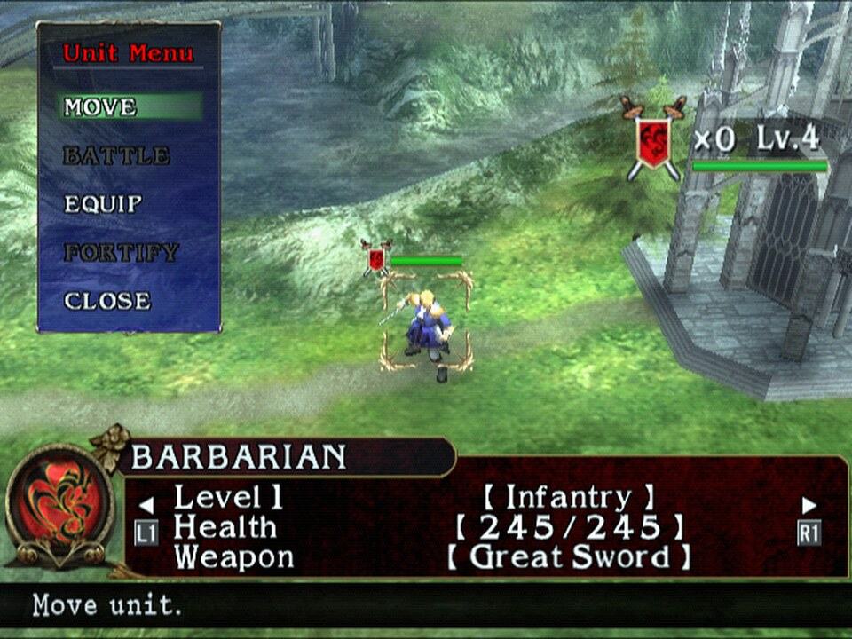
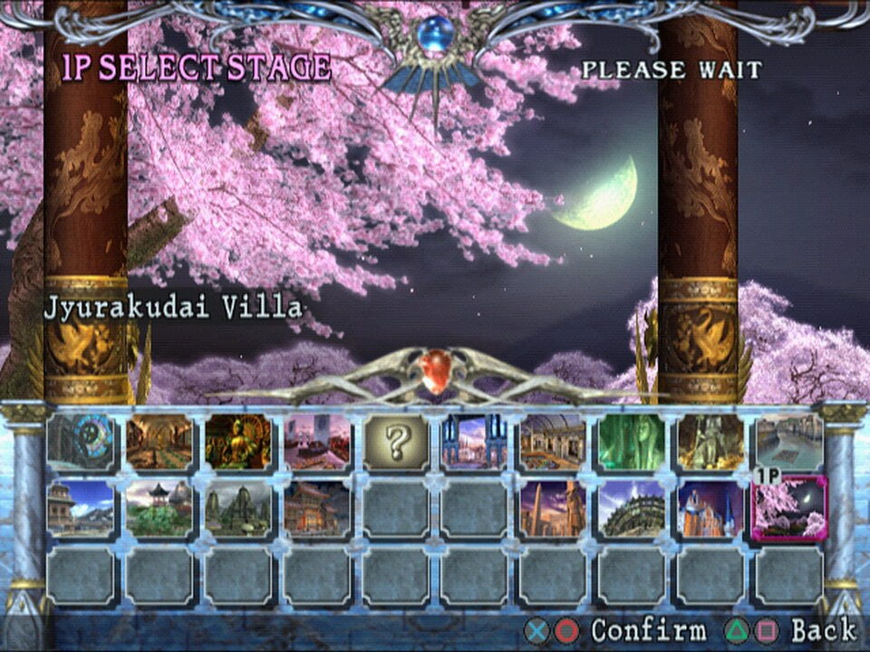

<div align="center">

# SoulCaliburIII_Recomp

**A native Linux port of *Soulcalibur III* (NTSC-U, `SLUS-21216`), made by statically recompiling the game's PlayStation 2 code to C++.**<br>
Not an emulator: the game's own MIPS R5900 code, rebuilt as a native program on a reimplementation of the PS2 hardware.


 
 
 

<sub>Captured from the running port (640x448 internal resolution, GPU renderer).</sub>

</div>

> [!IMPORTANT]
> No game files are included: no ELF, IRX modules, AFS archives, or code generated from them.
> You need **your own copy** of the North American release, PS2 ID **`SLUS-21216`**. The port is built against that disc's executable:
>
> | File | SHA-1 |
> |---|---|
> | `SLUS_212.16` | `9bbb67a70137052931bc245855eedeee6bbe5b49` |

## Status

**Playable from start to finish in automated tests, now in human testing.** Fights run at 60 frames per second in
real time on a Ryzen 7 7800X3D with the GPU renderer, with music and voices. Every mode has been played through with
scripted input: Tales of Souls to the credits, Chronicles of the Sword battles on the field map, World Competition,
Soul Arena, Museum, Character Creation, Shop and Options, with saves loaded back after a restart.

| Milestone | |
|---|:---:|
| Map and recompile the main ELF (12,900 functions) | ✅ |
| Boot: EE kernel, the game's own IOP modules, CD reads from the disc files | ✅ |
| Logos and movies (CRI Sofdec, decoded on the host) | ✅ |
| Title screen, menus, character and stage select | ✅ |
| Music and voices (CRI ADX on the game's own `CRI_ADXI.IRX`, SPU2) | ✅ |
| Fights at 60 fps (VU1 on its own thread, GPU renderer) | ✅ |
| Tales of Souls, World Competition, Soul Arena, Museum, Shop | ✅ |
| Chronicles of the Sword: story, field map, battles | ✅ |
| Memory card: save and load | ✅ |
| Long play sessions by a human | 🔧 |
| Widescreen, higher resolution | ⏳ |

✅ works · 🔧 in progress · ⏳ not reached yet

[RECOMP_NOTES.md](RECOMP_NOTES.md) records how the port was brought up, every fix and how it was found.

## Goal

A fully playable *Soulcalibur III* as a native executable, every mode from the opening movie to the endings, at the
original 60 frames per second. Accuracy first; once it is solid, widescreen and higher internal resolution.

## How it works

```
disc files ──► Ghidra (headless, EE) + ps2_analyzer + recomp/*_hints.txt ──► recomp/sc3.toml
                                           │
                                ps2_recomp ──► C++ (one file per function)
                                           │
             VU1/VU0 microcode in the ELF ──► ps2_vu_aot ──► C++ (generated/vu1/)
                                           │
   PS2Recomp runtime: EE kernel HLE · DMAC · GIF/GS · VIF/VU0/VU1 ─┼─► ps2EntryRunner
   PS2Recomp IOP:     R3000A interpreter running the game's own IRX · SPU2 · SIO2
```

- The ELF has no symbols. Ghidra maps the functions; `scripts/find_code_pointers.py` adds those reached only through
  pointers, jump tables or tail calls (the hint lists in `recomp/`).
- PS2Recomp turns every function into C++. `ps2_vu_aot` finds the VU1 and VU0 microprograms in the ELF and compiles
  them ahead of time; VU1 runs on its own thread ahead of the game, syncing only when the game reads VU1 state.
- The GS is drawn on the GPU by [paraLLEl-GS](https://github.com/Arntzen-Software/parallel-gs) (Vulkan compute), with
  the CPU rasterizer as fallback.
- `runtime/sc3_overrides.cpp` holds the game-specific bindings: reserved memory, a host Sofdec movie player and
  mixer, the renderer and timing choices, and diagnostic tracers.

The runtime is the `PS2Recomp/` git submodule: [boubou666/PS2Recomp](https://github.com/boubou666/PS2Recomp), branch
`main`, the fork shared with the *Twisted Metal: Black*, *Valkyrie Profile 2: Silmeria*, *The Lord of the Rings: The
Third Age* and *Drakengard* recompilations. There is no SC3 branch: the port builds on the same runtime as the others.
The top-level `CMakeLists.txt` builds its runtime, swaps its placeholder function table for the generated one and
links the generated code, `runtime/` and the compiled VU1 microcode into `ps2EntryRunner`. Every fix made for this
port is generic and on that `main`, for example the IOP interrupt suspension that kept CRI ADX streams alive, the VU0
VCLIP flags and VU1 run-ahead on its own clock.

## Requirements

- Linux (developed on Arch)
- CMake 3.21+, Ninja, Clang with C++20, rsync, and bsdtar (libarchive) to extract the disc
- FFmpeg development libraries (`libavcodec`, `libavformat`, `libavutil`, `libswresample`, `libswscale`)
- X11/Wayland and OpenGL development headers (raylib is fetched and built by the runtime)
- A Vulkan driver for the GPU renderer (any recent NVIDIA, AMD or Intel driver)
- Ghidra with the Emotion Engine extension, only to regenerate the function map
- Your own copy of `SLUS-21216` as a disc image (the extracted ELF is checked against the hash above)

## Build and run

```bash
git clone --recurse-submodules https://github.com/Arzaroth/SoulCaliburIII_Recomp.git
cd SoulCaliburIII_Recomp
scripts/extract_iso.sh "/path/to/Soulcalibur III (USA).iso"   # disc files -> game/
scripts/build_tools.sh                                         # ps2_recomp, ps2_analyzer, ps2_vu_aot -> build/tools
scripts/recomp.sh                                              # SLUS_212.16 + recomp/sc3.toml -> generated/, VU microcode -> generated/vu1/
scripts/build_runtime.sh                                       # runtime + generated code -> build/game (RelWithDebInfo)
scripts/run.sh                                                 # ps2EntryRunner game/SLUS_212.16
```

The extracted disc folder is the game's `cdrom0:`; the memory cards (`mc0/`, `mc1/`) are created next to the ELF in
`game/`.

`JOBS=<n>` sets the build parallelism of every script (default: all cores). The generated code is about 12,900 C++
files; a clean build of the tools and the game (recompile included) takes about 13 minutes with `JOBS=8` on a Ryzen 7
7800X3D, most of it the runner. `scripts/build_runtime.sh Release` or `Debug` picks another build type, and `CXX`
another compiler (Clang is used when it is installed).

`scripts/regress.sh build/game ~/sc3-regress` checks a build for regressions: it boots with movies off, goes through the
menus into a Free Training fight, attacks for a minute, then writes a verdict to `summary.txt` (route reached, ok,
hang or crash, GS frame rate, SPU2 underruns) with the last frame and the log.

A controller is used when one is connected; otherwise the keyboard (US key positions). A second gamepad plays
player 2:

| PS2 button | Keyboard |
|---|---|
| D-pad | Arrow keys or W A S D |
| Cross / Circle / Square / Triangle | X or Space / C or Esc / Z or Numpad 0 / V or Numpad 1 |
| L1 / R1 / L2 / R2 | Q / E / Left Shift / Right Shift |
| Start / Select | Enter / Tab |

| Key | What it does |
|---|---|
| F1 | Runtime debugger |
| F3 | Frame rate and emulated EE speed overlay (`PS2X_SHOW_FPS=1` starts with it on) |

<details>
<summary><b>Runtime and diagnostic options</b></summary>

| Variable | Effect |
|---|---|
| `PS2X_GS_RENDERER=cpu` | Draw with the CPU rasterizer. The default is the GPU (paraLLEl-GS, Vulkan), which falls back to the CPU when no Vulkan device is found |
| `PS2X_VIF1_THREAD=0` | Run VIF1 and the VU1 microcode on the game thread (default: their own thread, about a third faster in fights) |
| `PS2X_EE_CATCHUP=0\|field\|1` | Wall-clock catch-up: SC3 defaults to off, so emulated time never runs faster than real time |
| `PS2X_SC3_NO_MOVIES=1` | Skip the one-shot movies (for tests) |
| `PS2X_SC3_AUTOWIN=1` | Keep the player at full health and the opponent at 1 HP, so scripted input wins each fight |
| `PS2X_PAD_SCRIPT=t:BUTTON[/ms],…` | Scripted button presses (seconds from start); `PS2X_PAD_INPUT=<file>` reads presses appended to a file while the game runs |
| `PS2X_PAD2_SCRIPT=t:BUTTON[/ms],…` | Player 2's scripted presses in the same format; plugs in the second controller without a second gamepad |
| `PS2X_STATE_DUMP=<s>` | Every few seconds: EE and IOP threads, GS frames, EE speed, DMA and VIF counters, SPU2 state |
| `PS2X_FRAME_DUMP=<dir>`, `PS2X_FRAME_DUMP_EVERY=<s>` | Save the presented frame as raw 640x448 RGBA |
| `PS2X_PROFILE=<s>` | Sampling profiler: where every host thread spends its time |
| `PS2X_EE_PROFILE=1` | EE cycles by guest loop, in the state dump |
| `PS2X_GS_DUMP_WHEN=<file>` | Log the next GS primitives once that file appears (`PS2X_GS_DUMP_OUT`, `PS2X_GS_DUMP_COUNT`) |
| `PS2X_SC3_TRACE_ADXT=1`, `_TASKS`, `_ENTRY=<addr,…>`, `_OBJ`, `_FADE`, `_MOVIE` | Game tracers: ADX player states, task creation, guest function entries, object fields, fades, movies |

</details>

## Disc facts

| | |
|---|---|
| Boot ELF | `SLUS_212.16`, entry `0x100008`, stripped |
| Video mode | NTSC (`SYSTEM.CNF` `VER = 1.01`) |
| IOP modules | `IRX/*.IRX`: CRI_ADXI, LIBSD, MCMAN, MCSERV, NUSOUND, PADMAN, SDRDRV, SIO2MAN |
| IOP image | `IOPRP300.IMG` |
| Data | `ROOT.OLK`, `BGM.AFS`, `SE.AFS`, `VOICE.AFS`, `MOVIE.AFS` (Sofdec) |

## Repository layout

| Path | Contents |
|---|---|
| `PS2Recomp/` | The recompiler and runtime (git submodule, boubou666/PS2Recomp branch `main`) |
| `CMakeLists.txt` | Builds the runtime with the generated code and the game overrides linked in |
| `recomp/` | Recompiler config (`sc3.toml`), the Ghidra function map and the entry-point hint lists |
| `runtime/` | Game override module (`sc3_overrides.cpp`) |
| `scripts/` | Build, recompile and run scripts; disassembly, IRX and profiling helpers |
| `patches/` | Experiments kept for reference |
| `docs/screenshots/` | Pictures of the running port |
| `RECOMP_NOTES.md` | How the port was brought up, the fixes and the debugging tools |
| `game/`, `generated/`, `build/` | Created by the scripts, ignored by git: disc files, generated C++, builds |

Everything derived from the game (disc files, generated code, builds, logs) stays outside this repository.
Never commit or redistribute it.

## Credits

- [PS2Recomp](https://github.com/ran-j/PS2Recomp) by ran-j and contributors (GPL), the recompiler and runtime this port is built on.
- [boubou666/PS2Recomp](https://github.com/boubou666/PS2Recomp) and the *Twisted Metal: Black*, *Valkyrie Profile 2: Silmeria*, *The Lord of the Rings: The Third Age* and *Drakengard* recompilations developed on it; runtime fixes are shared both ways.
- [paraLLEl-GS](https://github.com/Arntzen-Software/parallel-gs) by Arntzen Software (Hans-Kristian Arntzen, Runar Heyer), LGPL-3.0+, the GPU renderer; fetched at build time by the PS2Recomp runtime.
- *Soulcalibur III* © Bandai Namco Entertainment, developed by Project Soul. This is an unofficial fan project, not affiliated with or endorsed by them.
