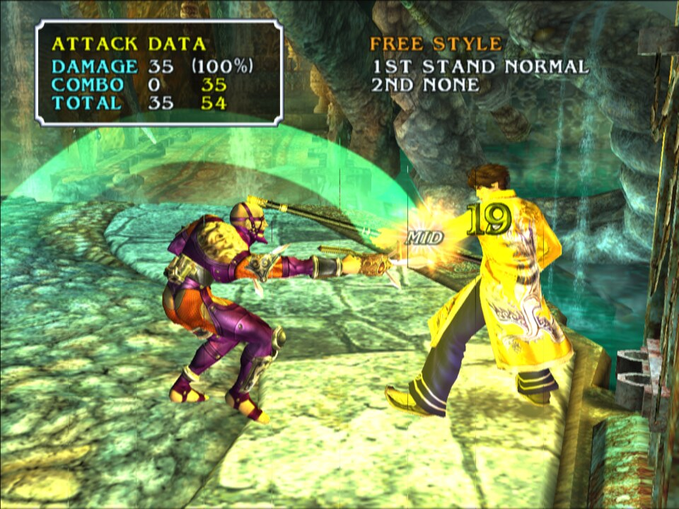
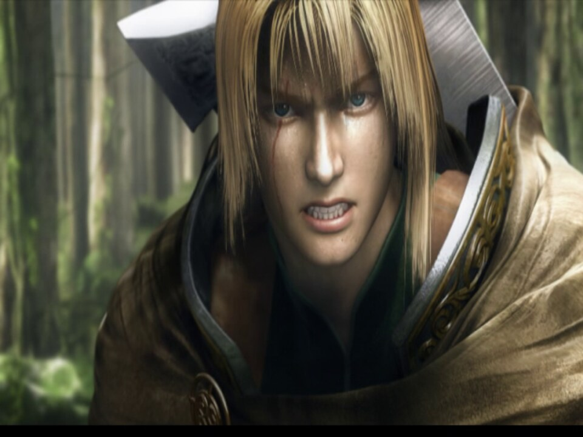

<div align="center">

# SoulCaliburIII_Recomp

**A native Linux port of *Soulcalibur III* (NTSC-U, `SLUS-21216`), made by statically recompiling the game's PlayStation 2 code to C++.**<br>
Not an emulator: the game's own MIPS R5900 code, rebuilt as a native program on a reimplementation of the PS2 hardware.


 
 
 
 

<sub>Captured from the running port: native OpenGL GS renderer at twice the internal resolution
(<code>PS2X_GS_SCALE=2</code>, 1280x896), scaled to 960x720.</sub>

</div>

> [!IMPORTANT]
> No game files are included: no ELF, IRX modules, AFS archives, or code generated from them.
> You need **your own copy** of the North American release, PS2 ID **`SLUS-21216`**. The port is built against that disc's executable:
>
> | File | SHA-1 |
> |---|---|
> | `SLUS_212.16` | `9bbb67a70137052931bc245855eedeee6bbe5b49` |

## Status

**Playable from start to finish in automated tests, now in human testing.** The port runs on PS2Recomp's native
target: the GS stream drawn with OpenGL, the VU1 microprograms on the native sandbox, the IOP modules recompiled, the IOP and the SPU2 on the wall clock, the frame loop and the movies on real time. Fights run at about
60 frames per second on a Ryzen 7 7800X3D, with music and voices. Every mode has been played through with scripted input: Tales
of Souls to the credits, Chronicles of the Sword battles on the field map, World Competition, Soul Arena, Museum,
Character Creation, Shop and Options, with saves loaded back after a restart. The game runs its own `rand`: the
15-bit stub it used to be bound to made every random pick 0.

| Milestone | |
|---|:---:|
| Map and recompile the main ELF (12,900 functions) | ✅ |
| Boot: EE kernel, the game's own IOP modules, CD reads from the disc files | ✅ |
| Logos and movies (CRI Sofdec, decoded on the host) | ✅ |
| Title screen, menus, character and stage select | ✅ |
| Music and voices (CRI ADX on the game's own `CRI_ADXI.IRX`, SPU2) | ✅ |
| Fights at 58-60 fps (VU1 on its own thread) | ✅ |
| Tales of Souls, World Competition, Soul Arena, Museum, Shop | ✅ |
| Chronicles of the Sword: story, field map, battles | ✅ |
| Memory card: save and load | ✅ |
| Random picks (the game's own `rand`) | ✅ |
| Long play sessions by a human | 🔧 |
| Native GS renderer (OpenGL), recompiled IOP modules, IOP and SPU2 on the wall clock | ✅ |
| Higher internal resolution (`PS2X_GS_SCALE`) | ✅ |
| Frame loop on the native FramePacer | ✅ |
| VU1 microprograms on the native sandbox, no emulated VU1 | ✅ |
| Widescreen | ⏳ |

✅ works · 🔧 in progress · ⏳ not reached yet

### Native target

The port runs on the native target the other PS2Recomp ports use. It pins PS2Recomp's `sc3/native-vu1` integration
branch: `native/renderer` plus the SC3 fixes below, on their way into `native/renderer`.

- **Native GS renderer**: PS2Recomp's GS back end translates the GS stream into OpenGL draws (`GSNativeBackend`),
  with no GS emulation. SC3 needed these
  fixes in it: pixels sampled at their integer coordinates as the GS does (a one-pixel seam every 64 pixels and a
  soft picture before), HIGHLIGHT and HIGHLIGHT2 adding the vertex alpha at its own scale, blending with Ad at the
  GS's scale, draws testing against the Z buffer their ZBUF names (the shadow pass darkened the whole frame), and
  for the character shadows: blends with COLCLAMP off keeping the low 8 bits (the shadow volumes count by wrapping
  past white), a colour buffer read as Z in the Z format's block order, and untextured draws at their own colour.
- **Higher internal resolution**: `PS2X_GS_SCALE=2` draws at 1280x896. The screenshots above come from it.
- **IOP modules recompiled**: `scripts/iop_recomp.sh` turns the eight IRX modules into native code (813 functions,
  none left to the interpreter); `PS2X_IOP_NATIVE=0` interprets them again.
- **SPU2 on the wall clock** by default (`PS2X_SPU2_WALLCLOCK=1` in the scripts), with an AutoDMA fix so the ADX
  stream gets each half's interrupt in time, and kept within 512 samples of the IOP clock.
- **IOP on the wall clock** by default (`PS2X_IOP_WALLCLOCK=1`, set by the game override; `=0` puts it back on the
  EE cycles the game accounts): its timers, vblank interrupts and sound driver ticks follow real time, at no cost in
  fps (59.8 capped, 58.6 with the fight uncapped, against 59.3 and 57.8 on the EE clock).
- **Frame loop on real time** by default: the main loop's frames are paced by PS2Recomp's FramePacer and shown when
  the game ends them, not on the vblank grid (`SC3_NATIVE_FRAMES=0` goes back to it). One-shot movies too: their loop
  ends its frames in a vsync wait of CRI's ADXM, which the override turns into the same native frame end, so they
  play at their 29.97 pictures a second on the host's clock, with their sound in step. `PS2X_FRAME_CAP` sets the cap
  (60 by default, 0 = unlimited).
- **VU1 microprograms on the native sandbox** by default: PS2Recomp's `Vu1StreamAdapter` runs every MSCAL of the
  VIF1 stream on its own copy of the AOT-compiled programs, on the VIF1 thread, and hands their XGKICK packets to the
  GS back end as native draws at their place in the GS stream; the emulated VU1 no longer draws anything
  (`SC3_NATIVE_VU1=0` gives it back). Every mode checked against VU1 looks the same: menus, title, attract fights,
  fights, Tales of Souls, Chronicles of the Sword (field map, battles, results), Character Creation and the movies.
  The hottest program, the fighters' skinned bodies (program B at 0x1388, about 313 runs a fight frame), runs as C++
  instead (`runtime/sc3_vu1_port.cpp`), bit for bit what the sandbox leaves: packets, VU memory, registers, flags
  and cycles (`SC3_NATIVE_VU1_PORT=0` puts it back on the sandbox, `=check` runs both and compares).
  Capped play holds 59.0-59.3 fps on the regression route; uncapped fights run about 56 fps (1.8 more than with
  every program on the sandbox) against VU1's 59-62.
- **Speed**: the regression route runs at 59.6 fps (58.2 on the vblank grid), with 5 frames over 25 ms instead of
  about 590; uncapped (`PS2X_FRAME_CAP=0`) it reaches 90 GS frames per second, 112 game frames per second.

[RECOMP_NOTES.md](RECOMP_NOTES.md) records how the port was brought up, every fix and how it was found.

## Goal

A fully playable *Soulcalibur III* as a native executable, every mode from the opening movie to the endings, at the
original 60 frames per second. Accuracy first; once it is solid, widescreen and higher internal resolution.

## How it works

```
disc files ──► Ghidra (headless, EE) + ps2_analyzer + recomp/*_hints.txt ──► recomp/sc3.toml
                                           │
                                ps2_recomp ──► C++ (one file per function)
                                           │
             VU1/VU0 microcode in the ELF ──► ps2_vu_aot ──► C++ (generated/vu1/)
                                           │
   PS2Recomp runtime: EE kernel HLE · DMAC · GIF/GS · VIF/VU0/VU1 ─┼─► ps2EntryRunner
   PS2Recomp IOP:     the game's own IRX, recompiled (generated/iop/) or interpreted · SPU2 · SIO2
```

- The ELF has no symbols. Ghidra maps the functions; `scripts/find_code_pointers.py` adds those reached only through
  pointers, jump tables or tail calls (the hint lists in `recomp/`).
- PS2Recomp turns every function into C++. `ps2_vu_aot` finds the VU1 and VU0 microprograms in the ELF and compiles
  them ahead of time; the VU1 programs run on PS2Recomp's native sandbox, on the VIF1 thread, and draw through the
  GS back end.
- The GS stream is translated into OpenGL draws by PS2Recomp's native GS back end, the CPU rasterizer stays as the
  validation reference.
- `runtime/sc3_overrides.cpp` holds the game-specific bindings: reserved memory, a host Sofdec movie player and
  mixer, the renderer and timing choices, and diagnostic tracers.

The runtime is the `PS2Recomp/` git submodule: [boubou666/PS2Recomp](https://github.com/boubou666/PS2Recomp), branch
`sc3/native-vu1` (`native/renderer` plus SC3's fixes and the native VU1 sandbox), the fork shared with the *Twisted Metal: Black*, *Valkyrie Profile 2: Silmeria*, *The Lord of the Rings: The
Third Age* and *Drakengard* recompilations; the port builds on the same runtime as the others.
The top-level `CMakeLists.txt` builds its runtime, swaps its placeholder function table for the generated one and
links the generated code, `runtime/` and the compiled VU1 microcode into `ps2EntryRunner`. Every fix made for this
port is generic and shared, for example the IOP interrupt suspension that kept CRI ADX streams alive, the VU0
VCLIP flags and VU1 run-ahead on its own clock.

## Requirements

- Linux (developed on Arch)
- CMake 3.21+, Ninja, Clang with C++20, rsync, and bsdtar (libarchive) to extract the disc
- FFmpeg development libraries (`libavcodec`, `libavformat`, `libavutil`, `libswresample`, `libswscale`)
- X11/Wayland and OpenGL development headers (raylib is fetched and built by the runtime)
- An OpenGL 4.5 driver (any recent NVIDIA, AMD or Intel driver)
- Ghidra with the Emotion Engine extension, only to regenerate the function map
- Your own copy of `SLUS-21216` as a disc image (the extracted ELF is checked against the hash above)

## Build and run

```bash
git clone --recurse-submodules https://github.com/Arzaroth/SoulCaliburIII_Recomp.git
cd SoulCaliburIII_Recomp
scripts/extract_iso.sh "/path/to/Soulcalibur III (USA).iso"   # disc files -> game/
scripts/build_tools.sh                                         # ps2_recomp, ps2_analyzer, ps2_vu_aot -> build/tools
scripts/recomp.sh                                              # SLUS_212.16 + recomp/sc3.toml -> generated/, VU microcode -> generated/vu1/
scripts/build_runtime.sh                                       # runtime + generated code -> build/game (RelWithDebInfo)
scripts/iop_recomp.sh && scripts/build_runtime.sh             # the IRX modules as native code -> generated/iop/
scripts/run.sh                                                 # ps2EntryRunner game/SLUS_212.16
```

The extracted disc folder is the game's `cdrom0:`; the memory cards (`mc0/`, `mc1/`) are created next to the ELF in
`game/`.

`JOBS=<n>` sets the build parallelism of every script (default: all cores). The generated code is about 12,900 C++
files; a clean build of the tools and the game (recompile included) takes about 13 minutes with `JOBS=8` on a Ryzen 7
7800X3D, most of it the runner. `scripts/build_runtime.sh Release` or `Debug` picks another build type, and `CXX`
another compiler (Clang is used when it is installed).

`scripts/remote_build.sh` builds the runner on another x86-64 Linux machine over ssh (`REMOTE_HOST`, default
`stallman`) and copies it back to `build/game`; the game still runs locally. It sends `CMakeLists.txt`, `runtime/`,
`generated/` and `PS2Recomp/` with rsync and builds them with Clang 23 from mise (conda-forge) on the remote host's
GCC headers, libstdc++ and linker, so the runner needs nothing newer than what the local machine has. The remote host
needs rsync, mise and the X11 and OpenGL development headers, but not FFmpeg: the local FFmpeg headers and libraries
are copied over once, so the runner links against the FFmpeg it runs with. On a 40-core Debian 12 host a clean runner
build takes about 4 minutes of compiling and 6 minutes overall, and a rebuild with nothing changed about 15 seconds.

`scripts/regress.sh build/game ~/sc3-regress` checks a build for regressions: it boots with movies off, goes through the
menus into a Free Training fight, attacks for a minute, then writes a verdict to `summary.txt` (route reached, ok,
hang or crash, GS frame rate, SPU2 underruns) with the last frame and the log.

A controller is used when one is connected; otherwise the keyboard (US key positions). A second gamepad plays
player 2:

| PS2 button | Keyboard |
|---|---|
| D-pad | Arrow keys or W A S D |
| Cross / Circle / Square / Triangle | X or Space / C or Esc / Z or Numpad 0 / V or Numpad 1 |
| L1 / R1 / L2 / R2 | Q / E / Left Shift / Right Shift |
| Start / Select | Enter / Tab |

| Key | What it does |
|---|---|
| F1 | Runtime debugger |
| F3 | Frame rate and emulated EE speed overlay (`PS2X_SHOW_FPS=1` starts with it on) |

<details>
<summary><b>Runtime and diagnostic options</b></summary>

| Variable | Effect |
|---|---|
| `PS2X_GS_RENDERER=cpu` | Draw with the CPU rasterizer, the reference, instead of the native GS back end |
| `PS2X_GS_SCALE=<n>` | Internal resolution multiplier of the native GS back end |
| `PS2X_IOP_NATIVE=0` | Interpret the IRX modules instead of running their recompiled code |
| `PS2X_IOP_WALLCLOCK=0` | Run the IOP on the EE cycles the game accounts instead of the host's clock |
| `SC3_NATIVE_VU1=0` | Run the VU1 microprograms on the emulated VU1 instead of the native sandbox |
| `SC3_NATIVE_VU1_PORT=0\|check` | Run the fighters' skinned bodies (B:0x1388) on the sandbox instead of in C++, or both, compared |
| `PS2X_VIF1_THREAD=0` | Run VIF1 and the VU1 microcode on the game thread (default: their own thread, about a third faster in fights) |
| `PS2X_EE_CATCHUP=0\|field\|1` | Wall-clock catch-up: SC3 defaults to off, so emulated time never runs faster than real time |
| `PS2X_SC3_NO_MOVIES=1` | Skip the one-shot movies (for tests) |
| `PS2X_SC3_AUTOWIN=1` | Keep the player at full health and the opponent at 1 HP, so scripted input wins each fight |
| `PS2X_PAD_SCRIPT=t:BUTTON[/ms],…` | Scripted button presses (seconds from start); `PS2X_PAD_INPUT=<file>` reads presses appended to a file while the game runs |
| `PS2X_PAD2_SCRIPT=t:BUTTON[/ms],…` | Player 2's scripted presses in the same format; plugs in the second controller without a second gamepad |
| `PS2X_STATE_DUMP=<s>` | Every few seconds: EE and IOP threads, GS frames, EE speed, DMA and VIF counters, SPU2 state |
| `PS2X_FRAME_DUMP=<dir>`, `PS2X_FRAME_DUMP_EVERY=<s>` | Save the presented frame as raw 640x448 RGBA |
| `PS2X_PROFILE=<s>` | Sampling profiler: where every host thread spends its time |
| `PS2X_EE_PROFILE=1` | EE cycles by guest loop, in the state dump |
| `PS2X_GS_DUMP_WHEN=<file>` | Log the next GS primitives once that file appears (`PS2X_GS_DUMP_OUT`, `PS2X_GS_DUMP_COUNT`) |
| `PS2X_SC3_TRACE_ADXT=1`, `_TASKS`, `_ENTRY=<addr,…>`, `_OBJ`, `_FADE`, `_MOVIE` | Game tracers: ADX player states, task creation, guest function entries, object fields, fades, movies |

</details>

## Disc facts

| | |
|---|---|
| Boot ELF | `SLUS_212.16`, entry `0x100008`, stripped |
| Video mode | NTSC (`SYSTEM.CNF` `VER = 1.01`) |
| IOP modules | `IRX/*.IRX`: CRI_ADXI, LIBSD, MCMAN, MCSERV, NUSOUND, PADMAN, SDRDRV, SIO2MAN |
| IOP image | `IOPRP300.IMG` |
| Data | `ROOT.OLK`, `BGM.AFS`, `SE.AFS`, `VOICE.AFS`, `MOVIE.AFS` (Sofdec) |

## Repository layout

| Path | Contents |
|---|---|
| `PS2Recomp/` | The recompiler and runtime (git submodule, boubou666/PS2Recomp branch `sc3/native-vu1`) |
| `CMakeLists.txt` | Builds the runtime with the generated code and the game overrides linked in |
| `recomp/` | Recompiler config (`sc3.toml`), the Ghidra function map and the entry-point hint lists |
| `runtime/` | Game override module (`sc3_overrides.cpp`) |
| `scripts/` | Build, recompile and run scripts; disassembly, IRX and profiling helpers |
| `patches/` | Experiments kept for reference |
| `docs/screenshots/` | Pictures of the running port |
| `RECOMP_NOTES.md` | How the port was brought up, the fixes and the debugging tools |
| `game/`, `generated/`, `build/` | Created by the scripts, ignored by git: disc files, generated C++, builds |

Everything derived from the game (disc files, generated code, builds, logs) stays outside this repository.
Never commit or redistribute it.

## Credits

- [PS2Recomp](https://github.com/ran-j/PS2Recomp) by ran-j and contributors (GPL), the recompiler and runtime this port is built on.
- [boubou666/PS2Recomp](https://github.com/boubou666/PS2Recomp) and the *Twisted Metal: Black*, *Valkyrie Profile 2: Silmeria*, *The Lord of the Rings: The Third Age* and *Drakengard* recompilations developed on it; runtime fixes are shared both ways.
- *Soulcalibur III* © Bandai Namco Entertainment, developed by Project Soul. This is an unofficial fan project, not affiliated with or endorsed by them.
